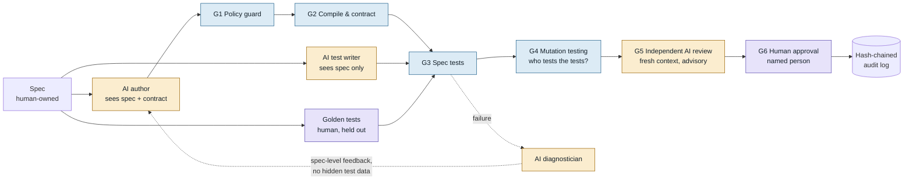

# AI Code Verification Gate

**How do you verify code that AI wrote, without letting AI grade its own homework?**

This project is a working answer. AI writes a payments component. Deterministic gates decide whether
it is correct. A second, independent AI reviews it and advises. A named human approves. Every step is
hashed into a tamper-evident audit log.

[繁體中文說明](README.zh-TW.md)

```
AI writes  →  deterministic gates decide  →  AI advises  →  human approves  →  audit log
```

## The idea in one picture



Blue gates **decide**. Amber AI roles **advise**. Purple steps belong to **a human**.

## Five rules the pipeline enforces

1. **No AI grades its own work.** The author never sees any test. The test writer never sees the code.
   The reviewer never sees the author's conversation. Each role is a separate model call.
2. **Correctness is decided by deterministic checks**: policy rules, the compiler, tests and mutation
   testing. AI findings can only be shown to a human; they cannot pass or fail a run.
3. **Tests come from the spec, not from the code.** Tests are data (input → expected ISO 8583 response
   code), so an AI can propose them without writing executable code, and a human can review them as a table.
4. **Who tests the tests?** Mutation testing plants small bugs on purpose. If the tests do not notice,
   they are not trusted, whoever wrote them.
5. **A named human is accountable.** Approval needs a name. Approving despite a HIGH AI finding needs an
   explicit `--ack-high`. Every run and decision goes into a hash-chained audit log.

## Responsible AI, enforced in code

| Principle | How the pipeline enforces it |
| --- | --- |
| Approved tools only | Live mode refuses any model that is not on the allow-list in [`config/ai-policy.json`](config/ai-policy.json). |
| No sensitive data to AI | Every prompt is scanned **before it is sent**. A card number (Luhn-valid), API key, password, email or Taiwan national ID blocks the call; nothing leaves the machine. PANs are masked in every report. |
| Disclose and review AI output | AI code gets a provenance record (`candidate/PROVENANCE.json`). Every prompt and answer is saved and hashed. Deterministic gates verify the code; an independent AI review is shown to the human. |
| A human is accountable | Gate G6 needs a named person. Approving despite a HIGH AI finding needs `--ack-high`. Approval is refused if the code changed after verification. |

The report shows this checklist with evidence from the latest run.

## The demo scenario

The component is a **card authorization pre-check** (ISO 8583 MTI 0100): it returns field 39 response
codes `30`, `14`, `54`, `13`, `51` or `00`. The spec is in
[`spec/authorization-precheck.md`](spec/authorization-precheck.md).

`./run.sh demo --full` runs three attempts. These numbers come from the pipeline itself:

| Attempt | What happened | Verdict |
| --- | --- | --- |
| 1 | AI tests **15/15 passed**. Human golden tests failed **6 of 31**: the card was declined during its own expiry month, and an amount equal to the balance was declined. The diagnostician explained the root cause and sent spec-level feedback, without leaking test data. | Blocked |
| 2 | Boundaries fixed. All **46** tests passed. Mutation testing: **98.6%** combined, but AI tests alone only **79.7%**, below the 80% gate. The independent AI reviewer raised a **HIGH** finding no test caught: `Character.isDigit()` accepts full-width Unicode digits, so the PAN `411111111111111３` was approved with `00`. | Rejected by human |
| 3 | The human added regression tests G-32 and G-33 (golden set v1.1). The author switched to an ASCII-only check. All **48** tests pass, mutation **98.6%**. One MEDIUM finding (null inputs, a gap in the spec) was accepted and logged. | Approved |

Each attempt shows a different layer catching what the previous layer missed.

Open `runs/report.html` after a run, or see the published report.

### About the AI answers in the demo

In offline mode the AI answers are **sample answers** stored in [`replay/`](replay/README.md), so the
demo runs anywhere without an API key. They are written to show typical failure patterns; they are not
recordings of a live model. **Everything that judges them is real**: the policy scan, compilation, all
tests, every mutant, the hashes and the audit log. Run with `--live` to replace every sample with a real
Claude call.

## Run it

Requires **JDK 21**. No other dependencies; nothing is downloaded.

```bash
./run.sh selftest                 # 27 checks of the engine itself
./run.sh demo                     # attempts 1 and 2, then stops at the human gate
./run.sh reject --by "Your Name" --note "Full-width digits must be rejected"
./run.sh run --attempt 3 --golden 1.1
./run.sh approve --by "Your Name"
./run.sh audit                    # verify the hash chain
./run.sh demo --full              # the whole story; the demo plays the human, labelled as scripted
```

On Windows use `run.cmd` with the same arguments.

**Live mode** (real Claude calls for author, test writer, reviewer and diagnostician):

```bash
export ANTHROPIC_API_KEY=...       # never written to logs or the audit trail
export AI_MODEL=claude-sonnet-5-5  # optional
./run.sh run --attempt 1 --live
```

Every prompt and answer is saved under `runs/<run>/ai/` and hashed into the audit log.

## Project layout

```
spec/                       Human-owned specification (AI reads, never changes)
src/main/java/dev/aiverify/
  contract/                 Human-owned interface the AI implements
  gates/                    G1 policy, G2 compile, G3 spec tests, G4 mutation, G5 AI review
  mutation/                 Source-level mutation operators (boundary, negation, logic, math, constants)
  ai/                       Roles and prompts; live Claude client and offline replay client
  pipeline/                 Orchestration, run context, hash-chained audit log
  report/                   Self-contained HTML report
tests/golden/               Human golden tests, versioned (v1.0, v1.1), held out from the author
replay/                     Sample AI answers for the offline demo
report/template.html        Report layout
```

## Design decisions

- **Zero dependencies.** Plain JDK: in-memory compilation (`javax.tools`), a small JSON reader, its own
  mutation engine. It runs in a locked-down bank network where Maven Central may be blocked.
- **Policy before compilation.** AI code is scanned before it is ever compiled: no file, network,
  process or reflection access, an import allow-list, no hard-coded secrets, and no PAN in logs (PCI DSS).
- **PANs are masked everywhere** in reports and in what the diagnostician sees, even test PANs, so the
  habit is the same as in production.
- **Feedback stays at spec level.** When tests fail, the author is told which rule it broke, never the
  hidden test inputs, so it cannot simply code to the test.
- **Integrity of the approval.** `approve` refuses if the code changed after verification (SHA-256 check).

## Limitations

- The policy gate is pattern-based. It is a fast first filter, not a sandbox; in production, run
  candidate code in an isolated container as well.
- The mutation engine is a small subset of what [PIT](https://pitest.org) does. Surviving mutants need a
  human look: in the demo the one survivor is an *equivalent mutant* (a doubled Luhn digit is always
  even, so `> 9` and `>= 9` behave the same).
- While building this, mutation testing also exposed a gap in the human golden tests (no expiry starting
  with a letter); test G-31 was added. Human tests need checking too.

## Using it in a real team

- **CI**: run the gates on every pull request that contains AI-written code; publish the report as a build artifact.
- **Coding agents**: expose the gates as tools (for example through an MCP server) so an agent such as
  Claude Code can run them while it works. The agent gets fast feedback, but the decision still comes
  from the gate and the human, not from the agent.
- **Other domains**: replace the spec, contract and golden tests. The gates do not know about payments.
